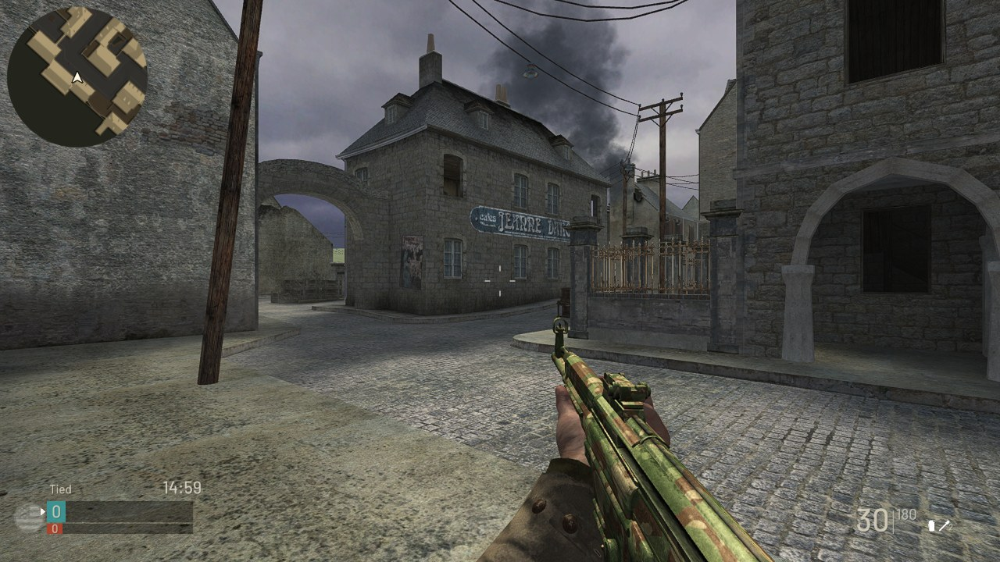
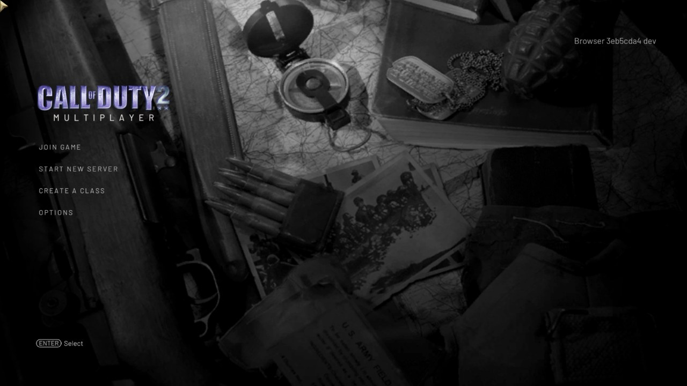
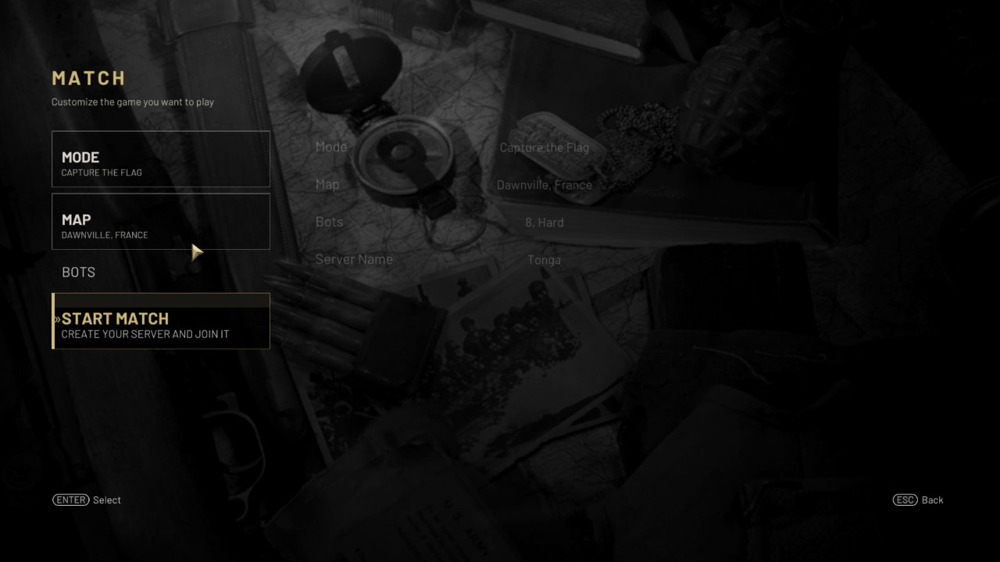
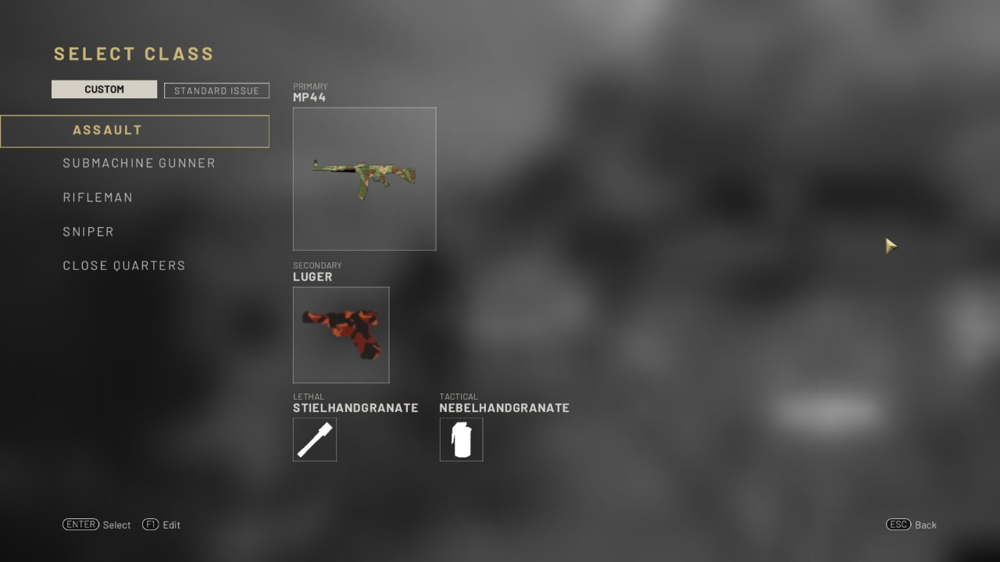
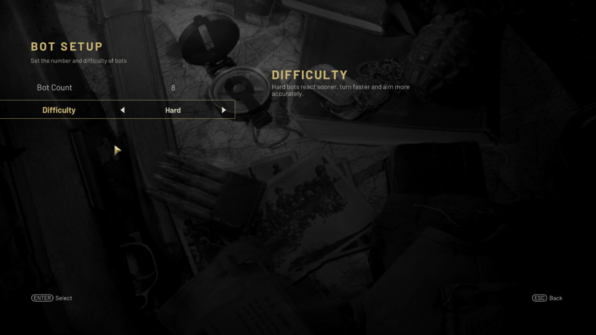
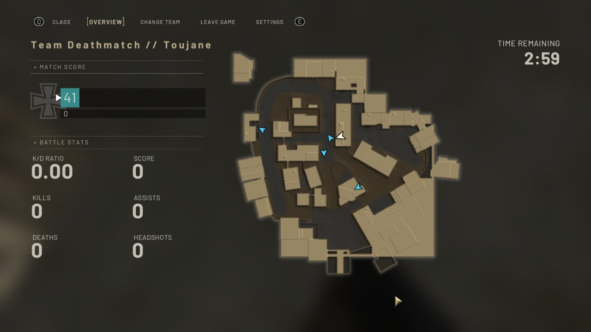
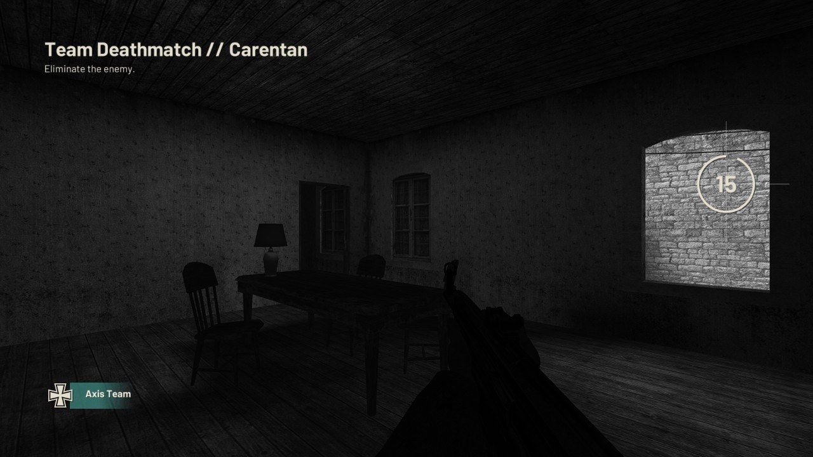

<div align="center">

# COD2 · REIMAGINED FOR THE BROWSER

**The battlefields of Call of Duty 2. A multiplayer experience inspired by Call of Duty: WWII.**

Custom classes · Functional attachments · Weapon camouflage · Objective bots · Modern HUD

**WebAssembly + WebGL 2** &nbsp; / &nbsp; **6 maps · 5 modes** &nbsp; / &nbsp; **Self-hosted multiplayer**

[Explore the features](#a-new-multiplayer-experience) · [Screenshots](#in-game) · [Host a game](#host-a-game) · [Documentation](#documentation)

</div>



**cod2-wasm** builds on the reconstructed CoD2 IW 2.0 engine and expands it into
a browser multiplayer game with its own loadouts, combat tuning, presentation
and hosting tools. Familiar maps, weapons and movement sit alongside a WWII-inspired
Create a Class system, working attachments, camouflage, server-controlled bots,
redesigned menus, sniper optics and a modern combat HUD.

Each player runs the game locally in their browser. A native dedicated server
runs the authoritative simulation, and a WebSocket-to-UDP gateway connects the
two. The host can be a desktop machine or a Raspberry Pi 5.

> **Actively developed, unofficial community project.** Hosting requires the
> owner's original CoD2 1.3 English game files. This repository contains the
> code and tools; game archives are supplied privately by the host.

## A new multiplayer experience

| Area | What you get |
| --- | --- |
| **Build your loadout** | Five named custom classes, 21 primary weapons, four pistols, lethal equipment and smoke; weapons from any faction on either team. |
| **Tune your weapons** | Up to three primary attachments and one pistol attachment, with weapon-specific choices, visible benefits and tradeoffs. |
| **Make it yours** | Ten camouflage patterns plus each gun's original finish, visible in first person, on other players' weapons and in class previews. |
| **Fight with bots** | Up to 32 bots per room, three difficulties, navigation, cover and objectives across all five game modes. |
| **Read the battlefield** | Circular minimap, shot indicators, hit markers, score popups, kill feed, team score panel, ammo display and redesigned scoreboard. |
| **Feel the combat** | Sprint, cover penetration, S-Mine 44, remote C4, mounted MG42 heat, custom weapon balance and safer respawns. |
| **See the difference** | WWII-style scopes, Reflex and Lens Sights, material lighting, aim depth of field, motion blur and improved effects. |
| **Play your way** | Keyboard and mouse or a remappable controller with vibration, stick settings and optional aim assist. |
| **Run your own matches** | In-game room creation, map rotation, custom rules, browser server list, persistent settings and Docker/Pi hosting. |

### Classes, attachments and camouflage

**Create a Class** gives each gametag five saved loadouts. Pick a primary from
any faction, a secondary pistol, a lethal item and smoke. Rename a class,
compare weapon ratings, fit attachments and choose a finish for each gun.
Choose **Custom** or **Standard Issue** when joining; edit your classes again
from the pause menu. A class change while alive applies on the next spawn.

Attachments change actual gameplay on both the server and the predicting client:
magazine capacity, fire rate, aim speed, recoil, spread, sway, range, penetration
and headshot damage. They also have costs, shown alongside their benefits.

| Role | Attachment options, depending on the weapon |
| --- | --- |
| Optics | Reflex Sight, Lens Sight, 4x Optic |
| Handling | Quickdraw, Grip, Steady Aim, Ballistic Calibration |
| Firepower | Extended Mag, Rapid Fire, Advanced Rifling, FMJ, High Caliber |
| Stealth | Suppressor: quieter shots, no muzzle flash and no enemy minimap shot indicator |

One optic can be fitted at a time. Reflex and Lens Sights have modeled frames
in the gun's own metal finish and illuminated reticles; their openings show
the world clearly while aiming. Sniper scopes and the 4x Optic keep the eyepiece
on screen with a magnified view through its glass. Holding your breath isolates
the scope view.

Camouflage paints the gun in play, including the weapon other players see.
Each primary and pistol can keep its own pattern.

[Class editor, weapon lists and attachment statistics →](docs/CLASSES.md)

### WWII-inspired presentation, from menu to final score

The redesigned interface runs inside the game:

- **Main menu and settings:** military typography, a subdued background,
  consistent navigation and pages for controls, graphics, audio and game settings.
- **Match creation:** choose a mode and map, inspect the map artwork, set time
  and score limits, configure bots and start the room.
- **Select Class and pause menu:** Custom / Standard Issue loadouts, class editing,
  team selection and a match overview with statistics and the full tactical map.
- **Prematch countdown:** a default 15-second introduction with desaturated
  gameplay, team and objective information, and a return to color as play begins.
- **Combat HUD:** minimap, enemy shot indicators, hit feedback, points,
  weapon icons, teammate labels, grenade warnings and contextual prompts.
- **Killcam and results:** redesigned replay presentation, scoreboard and
  end-of-match results before the next map loads.

Optional host-owned audio adds menu, countdown, final-minute and end-of-match
music, a hit sound and replacement weapon sounds. Optional weapon pictures add
colored loadout previews. [Private media setup →](docs/UPDATES.md#owner-sound-pack)

### Bots that play the mode

Bots are native server players. They move through map collision, see enemies
through visibility checks, fire and reload with ordinary weapon rules, and
respawn under the selected mode's rules. Walls, players and smoke block their
sight. Normal and Hard bots seek cover when wounded or reloading; snipers favor
sheltered firing lanes and relocate when compromised.

| Mode | Bot behavior |
| --- | --- |
| Deathmatch | Patrol, find opponents and fight independently. |
| Team Deathmatch | Spread out, share recent visible contacts, flank and engage at suitable ranges. |
| Capture the Flag | Attack, return and recover flags; intercept carriers, escort teammates and defend bases. |
| Headquarters | Reach the radio, capture or neutralize it, then defend it. |
| Search and Destroy | Split between sites, assign planting/defusing roles and cover the player interacting. |

Choose **Easy, Normal or Hard**, with reaction delays of 700, 400 and 200 ms
respectively. A room supports 0–32 bots, retains its bot settings across map
rotation, and waits for a human to spawn or spectate before its opening
countdown starts. Bots use ordinary player slots and need no browser instance.

This is custom multiplayer AI. Difficult navigation and tactical coordination
remain areas of active development. [Behavior, navigation and validation →](docs/BOT_AI.md)

### Combat with its own rules

- **Sprint:** run forward with Shift or L3, with lowered weapon and running
  animation. Sprint also stands up from crouch or prone when there is room.
- **Cover penetration:** material, thickness and weapon power determine how much
  damage a bullet retains through cover; FMJ increases penetration depth.
- **S-Mine 44:** place a bouncing mine, reclaim your own with Use, or shoot an
  enemy mine to detonate it. Friendly placed explosives carry team indicators.
- **C4:** throw a sticky charge and detonate it remotely with the aim input.
- **125 health:** regenerated health and a custom damage profile give submachine
  guns and pistols longer body-shot engagements than retail CoD2. Bolt-action
  rifles retain lethal body shots; two melee strikes kill a full-health player.
- **Real recoil and cartridge damage:** each gun's aimed kick follows its real
  free recoil, the cartridge's impulse against the gun's loaded weight: a BAR
  climbs harder than an MP40, a Garand kicks harder than a carbine. Damage
  follows the cartridge, from five body shots for a 7.62×25mm round to three
  for intermediate and full-power automatic rounds.
- **Mounted MG42:** sustained fire builds heat, forces cooling and increases recoil.
- **Respawns:** occupied and nearby exposed enemy positions are avoided when safer
  alternatives exist. TDM adds a three-second respawn countdown.
- **Movement and feedback:** crouch toggle, prone crawling, obstacle-checked
  mantling, cooked/returned frags, directional damage and blood feedback.

[Weapon balance](downstream/weapon-balance.json) · [Ballistics and controllers](docs/BALLISTICS_AND_GAMEPAD.md) · [Respawn rules](docs/RESPAWN_SAFETY.md)

### Rendering beyond the original browser port

The WebGL 2 renderer uses the original normal, specular and detail maps for
surface relief, sunlight response and weapon highlights. Softer baked shadow
edges, map fog and extended model detail distances improve the environments.

Aim depth of field, world and weapon motion blur, visible ejected casings,
reworked tracers, larger muzzle/grenade effects and nearby muzzle lighting add
to combat presentation. The HUD is composed separately from the 3D scene to
keep interface elements sharp.

The default output is **1920 × 1080**, with the 3D scene rendered at **720 lines**,
full-resolution base textures and 4× anisotropic filtering where supported.
Performance depends on the player's hardware, browser and match load.

[Graphics implementation and visual validation →](docs/GRAPHICS_2026-10-16.md)

## In game

These are actual project development captures. Individual screens may predate
later UI refinements; class artwork can depend on the host's optional media.

| Main menu | Create your match |
| :---: | :---: |
|  |  |
| **Camouflage selection** | **Select Class** |
|  |  |
| **Bots and difficulty** | **Tactical overview** |
|  |  |



## Maps and modes

Six original multiplayer maps, with all five modes available on each:

| Map | Setting | Allied force | Axis force |
| --- | --- | --- | --- |
| **Brecourt** · `mp_brecourt` | France | American | German Normandy |
| **Burgundy** · `mp_burgundy` | France | American | German Normandy |
| **Carentan** · `mp_carentan` | France | American | German Normandy |
| **Dawnville** · `mp_dawnville` | France | American | German Normandy |
| **Stalingrad** · `mp_railyard` | Russia | Soviet | German Winter |
| **Toujane** · `mp_toujane` | Tunisia | British | Afrika Korps |

**Deathmatch · Team Deathmatch · Capture the Flag · Headquarters · Search and Destroy**

Time and score limits are configurable per mode. TDM defaults to **15 minutes /
100 team points**. Rooms rotate through Toujane, Carentan, Dawnville, Burgundy,
Stalingrad and Brecourt while retaining their mode and rules.

The host starts with no rooms: players create them from **Start New Server**.
The browser list refreshes every five seconds. Up to **three rooms** can coexist,
with **64 configured slots per room**, including bots. These are configuration
limits, not a claim of tested 64-player capacity. Empty rooms close after five
minutes; their creator can also delete them from **Join Game**.

## Play

Once a host is running:

1. Open its address in a browser with WebAssembly and WebGL 2 support.
2. Let the game download and cache the host's prepared assets.
3. Set your gametag in **Options → Game Options** and build your classes.
4. Create a room with **Start New Server**, or select one in **Join Game**.
5. Choose a class and play. Use Escape for classes, match overview and settings.

Downloads show byte progress and are checked against archive sizes and SHA-256
hashes. Assets stay in IndexedDB between visits; the profile keeps controls,
name, audio and graphics settings. Clearing browser storage removes that profile.
Classes are stored by the gateway in SQLite under the gametag. **Gametags are
not authenticated accounts**: anyone using the same name shares its classes.
Room ownership is tied to a private token saved in the creator's browser.

### Keyboard and mouse

| Action | Default |
| --- | --- |
| Move / lean | W A S D / Q E |
| Fire / aim | Left / right mouse button |
| Sprint / scoped hold breath | Shift while moving forward / Shift while scoped |
| Reload / interact / melee | R / F / V |
| Crouch toggle / prone / stand or jump | C / Ctrl / Space |
| Frag / smoke | G / 4 |
| Cook or return a frag | Hold G, release to throw |
| S-Mine: place / reclaim | G / hold F over your mine |
| C4: equip / throw / detonate | G / fire / aim |
| Public chat / team chat / quick messages | T / Y / H |
| Pause / scoreboard / fullscreen | Escape / Tab / F10 |
| Class selection / edit or rename / camouflage | Enter / F1 / F2 |

Space first stands up from crouch or prone; another press while standing jumps.
Bindings are editable in **Options → Controls**.

### Controller

Connect an Xbox, PlayStation or other SDL-compatible controller and press a
button. Use a browser exposing the Gamepad API over **HTTPS or localhost**.

**RT/R2** fires, **LT/L2** aims, **A/Cross** jumps, **B/Circle** toggles crouch
(hold for prone), **X/Square** uses/reloads, **Y/Triangle** switches weapons,
**LB/L1** throws smoke, **RB/R1** throws a frag, **L3** sprints/holds breath,
**R3** melees and **Start/Options** pauses.

Controller settings include remapping, sensitivity, deadzone, inverted look,
vibration and optional aim assist. Bindings save separately from keyboard/mouse.
Aim assist slows the stick over a visible enemy and follows a small part of
its movement while the player moves a stick. Vibration support varies by browser.

## Host a game

### Requirements

- **Git, Python 3.9+, Node.js, Docker and Docker Compose.** Pi build/deploy tooling
  requires Python 3.12+; see the Pi guide for its complete requirements.
- Your original **CoD2 1.3 English IWDs**, including `localized_english_*.iwd`,
  placed in the ignored `data/main/` directory.
- The original installation ZIP/MP executable for favicon extraction, or a
  prepared `data/browser/web/cod2.ico`. The startup logo uses `data/main/iw_09.iwd`.
- A sibling checkout of **wasm-game-framework**. The build pins **0.9.2** at
  `53bc7e6eeef1ae35dcf3b25dea4e3ec0ab46726f`.

### Build and start

```sh
git clone https://github.com/tonga54/cod2-wasm.git
cd cod2-wasm
git clone https://github.com/theodorecharles/wasm-game-framework.git ../wasm-game-framework

# Copy your original English 1.3 IWD files into data/main/ before continuing.
python3 scripts/prepare-browser-bootstrap.py
python3 scripts/check-private-assets.py

# Set COD2_ORIGINAL_ZIP if your original installation ZIP is elsewhere.
./scripts/build-docker.sh
docker compose up -d
```

Open **http://localhost:8088/** on the host, or **http://HOST_LAN_IP:8088/**
from another machine. Create the first room from the game menu.

The build uses **Emscripten 3.1.64**, through Docker if it is unavailable locally.
`COD2_BUILD_JOBS` controls build parallelism; `COD2_WASM_FRAMEWORK_DIR` changes
the framework checkout path. `COD2_WEB_PORT` changes the published port, and
`COD2_WEB_DATA_DIR` selects the prepared private-data directory.

The current six-map asset manifest totals approximately **473.4 MB** (451.5 MiB).
The exact download depends on the prepared build and optional owner media;
[`site/wasm-game-data.json`](site/wasm-game-data.json) records sizes and hashes.
Original IWDs remain in `data/main/`, prepared files in `data/browser/`. Both
are excluded from Git; private game assets are mounted read-only at runtime.

### How it runs

```text
Player's browser                   Docker host
┌──────────────────────┐          ┌─────────────────────────────────────┐
│ WASM game + WebGL 2  │◄────────►│ Gateway :8088                      │
│ Local rendering     │ HTTP / WS│ ├─ Web shell + private asset delivery│
│ Input + prediction  │          │ ├─ Class storage (SQLite)            │
└──────────────────────┘          │ └─ Room supervisor → native servers │
                                  │                       UDP, internal │
                                  └─────────────────────────────────────┘
```

The standard dedicated engine is **32-bit x86 Linux** inside an amd64 container;
Docker Desktop handles execution on Apple Silicon. The gateway exposes the web
entry point; engine UDP ports and the room supervisor stay on internal networks.
Each room has its own authoritative engine process. The `cod2-classes` volume
persists class data.

### Raspberry Pi 5

A Pi can host the web service, gateway and matches while players render on
their own computers. The tested host is a **Pi 5 with 8 GB RAM, 64-bit Debian
and 4 KiB kernel pages**. Web/gateway/supervisor processes run as ARM64; the
32-bit x86 game engine runs through QEMU.

After preparing the host and your private assets, build on your computer and deploy:

```sh
DOCKER_DEFAULT_PLATFORM=linux/arm64 ./scripts/build-docker.sh
./scripts/deploy-pi.sh USER@PI_LAN_IP
```

The [complete Pi guide](docs/RASPBERRY_PI.md) covers initial setup, HTTPS,
deployment, optional signed Cloudflare asset delivery, updates and troubleshooting.
Use the configured HTTPS address on secured installations.

## Performance and development

Production defaults to **30 server ticks/s**, **30 requested snapshots/s** and
up to **60 input packets/s**. Actual delivery depends on bandwidth and load.
Rendering follows the display cadence, including 120 Hz on suitable clients.

Measured results have different scopes:

| Measurement | Result | Scope |
| --- | --- | --- |
| Pi 5, eight protocol clients + 16 Hard bots | 30.20 updates/s/client; 86.8% of one CPU core | Server/network sample; [report](docs/SERVER_PERFORMANCE_2026-10-13.md). |
| Pi tick-rate comparison | 30 Hz retained as the default | 50 Hz saturated a core under the heavier tested load; [benchmark](docs/TICKRATE_BENCHMARK_2026-10-12.md). |
| Development Mac rendering | About 120 FPS in documented gameplay checks | Specific desktop/display and short samples; [graphics report](docs/GRAPHICS_2026-10-16.md). |

These are measurements, not minimum FPS or maximum-player guarantees. Bot pathing,
client hardware and crowded matches still need testing under the intended load.
Detailed build, gameplay and deployment evidence is in [RUNBOOK.md](RUNBOOK.md).

### Checks

```sh
# Browser, shared gameplay, rendering, networking and UI regressions
./scripts/test-static.sh

# Gateway: rooms, transport, ownership, classes and updates
(cd downstream/gateway && npm ci && npm test)

# Private asset integrity and custom balance
python3 scripts/check-private-assets.py
python3 scripts/test-weapon-balance.py
```

Runtime checks for classes, explosives and GPU fixtures are documented in the
[technical reference](docs/TECHNICAL_REFERENCE.md#performance-and-verification).

### Updates

```sh
python3 scripts/update-local.py          # Check
python3 scripts/update-local.py --apply  # Fast-forward, rebuild, restart an empty host
```

`main` is the maintained branch. Standard installation requires a clean checkout
and no active players. Pi hosts use the Pi update procedure: validated releases
are checked every five minutes and activated when idle, with rollback on failed
activation. Browser players see an update action after leaving their match and
choose when to reload. [Update operations and cache behavior →](docs/UPDATES.md)

## Documentation

| Guide | Contents |
| --- | --- |
| [Classes and equipment](docs/CLASSES.md) | Weapons, attachments, camouflage, explosives, persistence and limits |
| [Bot AI](docs/BOT_AI.md) | Objectives, perception, navigation, difficulty and test scope |
| [Graphics](docs/GRAPHICS_2026-10-16.md) | WWII-style UI, optics, lighting, effects and visual evidence |
| [Ballistics and gamepad](docs/BALLISTICS_AND_GAMEPAD.md) | Cover penetration, controller behavior and verification |
| [Respawn safety](docs/RESPAWN_SAFETY.md) | Spawn selection and crowded-map behavior |
| [Raspberry Pi](docs/RASPBERRY_PI.md) | Host setup, deployment, HTTPS, CDN and load testing |
| [Updates and private media](docs/UPDATES.md) | Releases, caching, music, sounds and class pictures |
| [Technical reference](docs/TECHNICAL_REFERENCE.md) | Detailed gameplay rules, restored behavior, room API and operational checks |
| [Client performance](docs/PERFORMANCE_2026-10-16.md) / [server performance](docs/SERVER_PERFORMANCE_2026-10-13.md) | Optimization measurements and their limits |
| [Runbook](RUNBOOK.md) | Development history, runtime evidence and troubleshooting |
| [Source audit](SOURCE_BASE_AUDIT.md) | Reconstructed source base and provenance |

## Credits and original assets

This fork builds on [theodorecharles/cod2-wasm](https://github.com/theodorecharles/cod2-wasm)
and [wasm-game-framework](https://github.com/theodorecharles/wasm-game-framework).
The interface and several gameplay additions take inspiration from **Call of Duty:
WWII**, adapted to this engine and its multiplayer rules.

Call of Duty names, maps, models, textures, sounds and original executables belong
to their respective rights holders. This is an unofficial project and supplies
neither a copy nor a license of the original games. Hosts must supply their own
original files privately. Screenshots illustrate the running project; original
game archives and standalone asset packs are not distributed in this repository.
