<div align="center">

# COD2 · REIMAGINED FOR THE BROWSER

**Call of Duty 2's battlefields with the multiplayer of Call of Duty: WWII, running in a browser tab.**

Create a Class · attachments · camouflage · S-Mine 44 and C4 · up to 32 bots · WWII combat HUD · real-time shadows

[](#how-it-runs)
[](#bots)
[](#maps-and-modes)
[](#host-a-game)

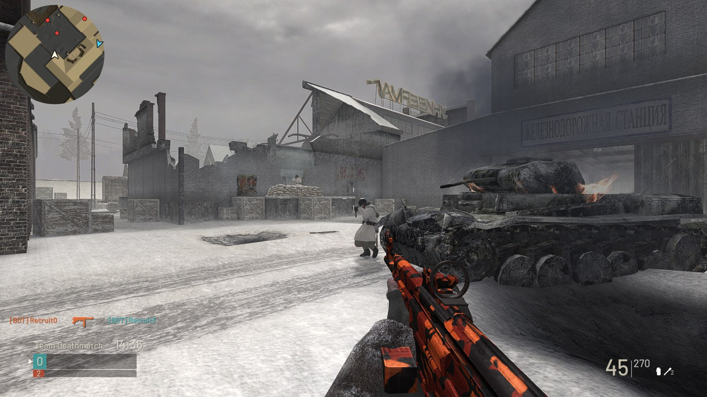

[See it in motion](#see-it-in-motion) · [What's new](#what-the-original-game-didnt-have) · [Play](#play) · [Host a game](#host-a-game) · [Documentation](#documentation)

</div>

**cod2-wasm** turns the reconstructed engine of Call of Duty 2 (2005) into a
browser multiplayer game with the loadouts, HUD and match flow of Call of Duty:
WWII (2017). Players open the host's address; the game downloads once and stays
cached. Every match runs on a native dedicated server on the host, a desktop
computer or a Raspberry Pi 5, and any player can create a room, fill it with
bots and play.

| 5 | 21 + 4 | 13 | 10 | 2 | 0–32 | 8 · 5 |
| :---: | :---: | :---: | :---: | :---: | :---: | :---: |
| custom classes | primaries + pistols | attachments | camouflages | placed explosives | bots per room | maps · modes |

> **Unofficial community project, in active development.** Hosting requires the
> owner's original CoD2 1.3 English game files. This repository contains the
> code and tools; game archives are supplied privately by the host.

## See it in motion

| MP44 · Ember · Reflex Sight | Scoped Kar98k | S-Mine 44 |
| :---: | :---: | :---: |
| 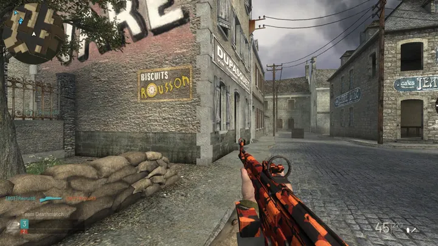 | 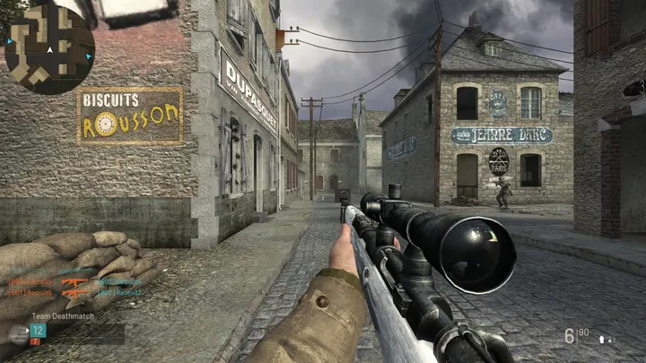 | 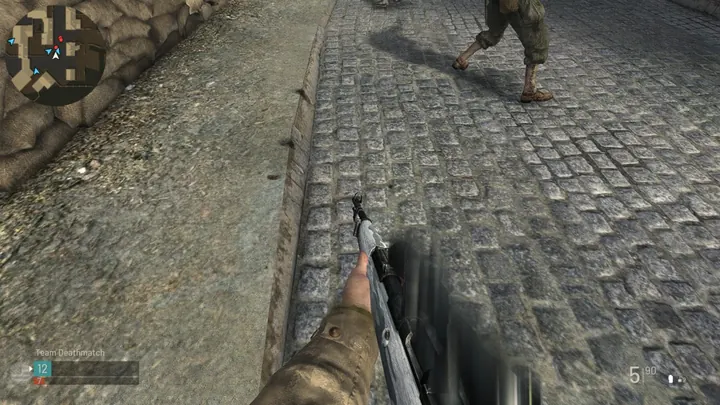 |
| Lit muzzle flash and brass on every round. | WWII's reticle, the world blurred around the glass, the kick of the shot. | Pin out, mine down, and a star only your squad can see. |

## Day one to today

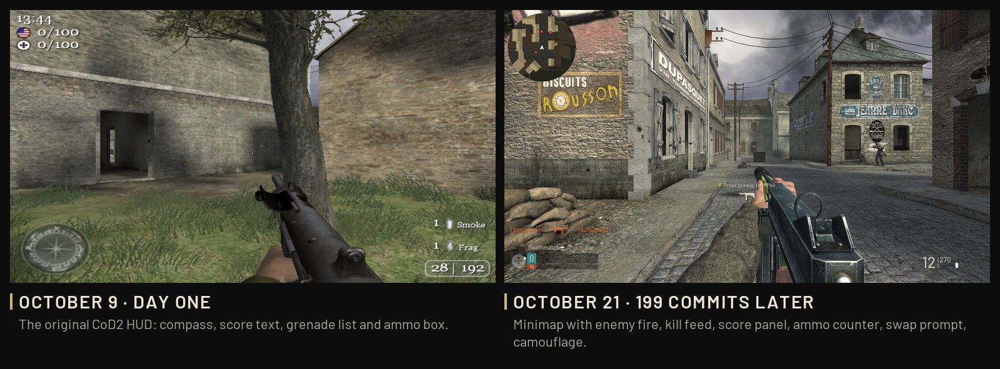

When this fork began, the upstream port compiled CoD2's reconstructed client to
WebAssembly, but the game did not link or launch yet. The first playable LAN
build arrived on October 9, 2026. Everything on the right came in the 199
commits that followed.

## What the original game didn't have

| | Call of Duty 2 multiplayer (2005) | cod2-wasm |
| --- | --- | --- |
| **Platform** | An installed PC game | A browser tab, or a web app installed from it |
| **Loadout** | A weapon from your side's list; pistol and grenades set by nationality | [Five named custom classes](#create-a-class), any faction's weapons on either team |
| **Gunsmith** | None | [13 attachments](#attachments-with-real-tradeoffs) with real gains and costs; [10 camouflages](#ten-camouflages) |
| **Sights** | Iron sights and sniper scopes | Plus [Reflex Sight, Lens Sight and 4x Optic](#sights-and-scopes), WWII reticles, scope glint |
| **Lethal equipment** | Frag grenades | Frags, plus the [S-Mine 44 and remote C4](#s-mine-44-and-c4) |
| **Opponents** | Human players only | [Up to 32 bots](#bots) at three difficulties, in all five modes |
| **HUD** | Compass, score text, ammo box | [Minimap, kill feed with weapon silhouettes, score panel](#a-combat-hud-from-call-of-duty-wwii), match points |
| **Movement** | Lean, crouch, prone, mantle | All of it, plus sprint |
| **Gun feel** | Retail recoil and damage | [Recoil from each gun's real free recoil, damage by cartridge](#combat-with-its-own-rules), penetration by material |
| **Match flow** | Killcam and scoreboard | [Prematch countdown, WWII killcam, victory screen, striped scoreboard](#from-the-countdown-to-the-final-score) |
| **Menus** | CoD2's own menus | [WWII's menus and settings](#menus-rebuilt-in-wwiis-style), a pause menu over the live match |
| **Hosting** | Listen and dedicated servers | One host serves the game and up to three rooms, on [Docker](#host-locally) or a [Raspberry Pi 5](#raspberry-pi-5) |

## A combat HUD from Call of Duty: WWII

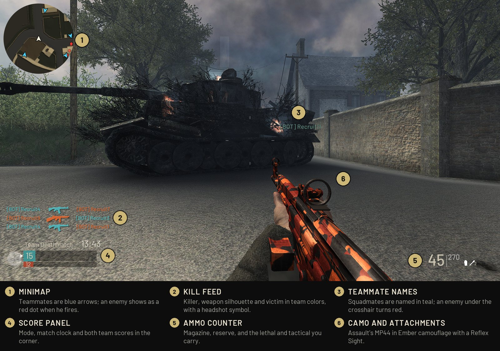

Every element of CoD2's HUD was redrawn in WWII's style and Barlow lettering,
on a 1080-line canvas composed apart from the 3D view so it stays sharp. Beyond
the six marked above:

- **WWII's hit markers:** a white X for a hit and a longer red one for a kill,
  with the host's hit sound when supplied.
- **A crosshair** that turns red over an enemy and teal over a teammate, and
  stays up while sprinting.
- **Match points** for kills, assists and objectives as you earn them.
- **WWII's grenade warning ring** and prompts to climb, swap weapons, hold your
  breath and reload.

## Create a Class

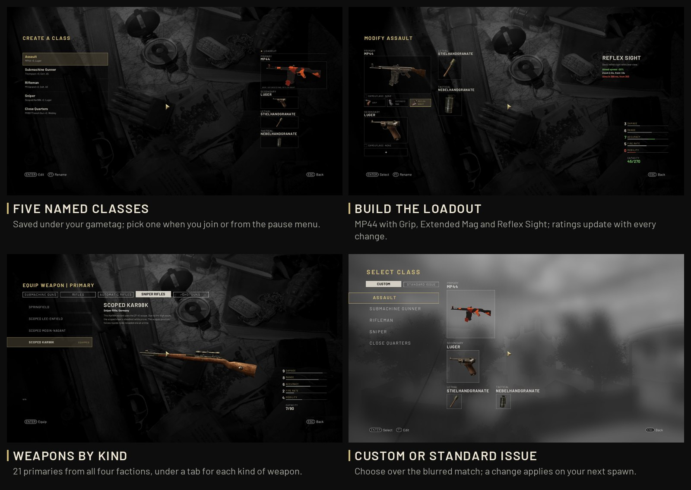

Every gametag gets **five named classes**. Each sets a primary with up to three
attachments, a pistol with one, a lethal item (a frag, the S-Mine 44 or C4) and
a smoke grenade. Any team can carry any country's weapons: a British player can
spawn with a Kar98k, a German one with an M1 Garand.

- **21 primaries** from all four factions, under tabs for Submachine Guns,
  Rifles, Automatic Rifles, Sniper Rifles and Shotguns; **4 pistols**: the
  Colt .45, Webley, TT-30 and Luger.
- **Rating bars** for damage, range, accuracy, fire rate and mobility change
  with every attachment.
- **Select Class** opens as you join, with your Custom classes and the
  Standard Issue set; in a match, Escape brings it back in the pause menu. A
  change while alive applies on your next spawn.

[Weapon lists, default classes and storage →](docs/CLASSES.md)

## Attachments with real tradeoffs

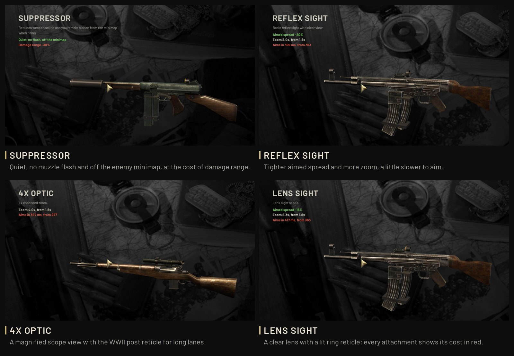

Attachments follow WWII's rules: three on the primary, one on the pistol, one
optic at a time, and each gun takes its WWII class's list. They change the
weapon for real, on the server and in the client's prediction, and every one
costs something, shown in red beside what it gives.

<details>
<summary><b>All 13 attachments, their gains and their costs</b></summary>

| Attachment | Gain | Cost |
| --- | --- | --- |
| Suppressor | Quiet, no muzzle flash, off the enemy minimap | Damage ranges −30% on SMGs, −15% on pistols |
| Reflex Sight | A red dot, more zoom, aimed spread −20% | Aim-in +10% |
| Lens Sight | An amber ring, more zoom, aimed spread −15% | Aim-in +15% |
| 4x Optic | A scope view at four times the zoom | Aim-in +25% |
| Extended Mag | Magazine and reserve +50% | Aim-in +10% |
| Rapid Fire | About 6% faster fire | Aimed kick +15% |
| Quickdraw | Aim-in −16% to −35% | Aimed kick +15% |
| Grip | Aimed view and gun kick −15% | Aim-in +10% |
| Steady Aim | Hip-fire spread −25% to −40% | Aim-in +10% |
| Advanced Rifling | Damage ranges up to ×1.25 | Aim-in +10% |
| FMJ | 25% deeper penetration through cover | Damage ranges −10% |
| High Caliber | Head and helmet damage ×1.5 | Aimed kick +15% |
| Ballistic Calibration | Aimed sway −40% | Aim-in +10% |

Costs multiply like the gains, and a suppressed shot also sounds suppressed: the
browser runs it through a suppressor's filters.

</details>

## Ten camouflages

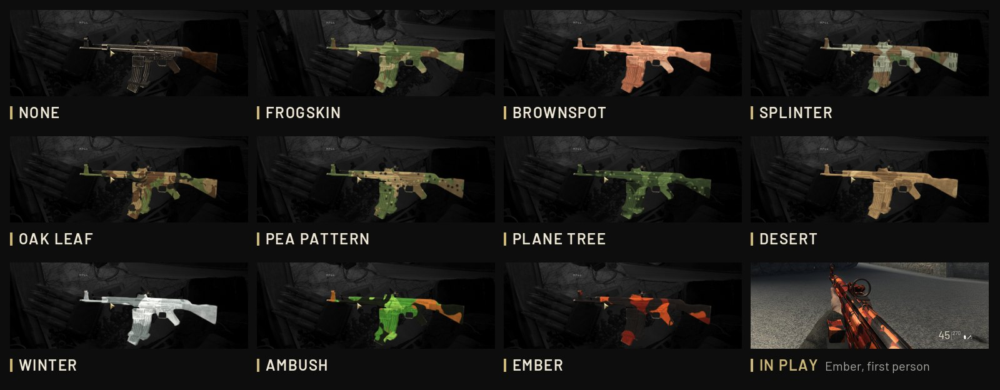

Each primary and pistol keeps its own pattern. Camouflage paints the gun in your
hands, the weapon other players see and the class previews, and a gun dropped
on the ground keeps its paint, attachments and rounds for whoever picks it up.

## Sights and scopes

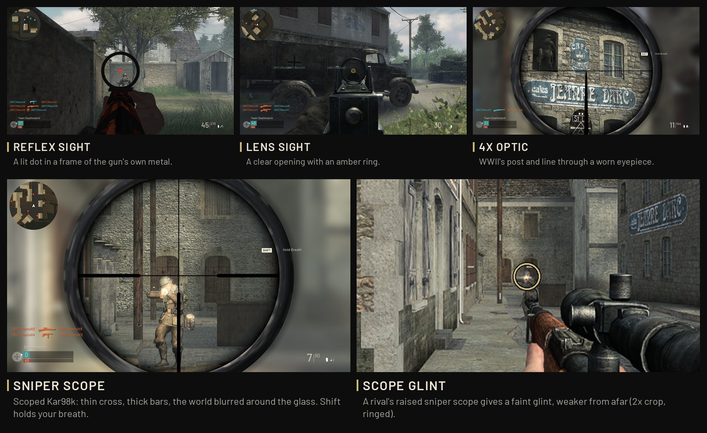

- **Reflex and Lens Sights** are modeled in the gun's own metal, with a lit
  red dot or amber ring and a clear view through the opening.
- **The 4x Optic and sniper scopes** raise WWII's scope: magnified glass in a
  round eyepiece of worn metal, the world blurred around it, and WWII's
  reticles, a post and line in the 4x Optic and the scoped Kar98k's thin cross
  with thick bars in every sniper scope. Shift holds your breath.
- **Scope glint:** a rival's raised sniper scope gives a faint glint, weaker
  at range.

## S-Mine 44 and C4

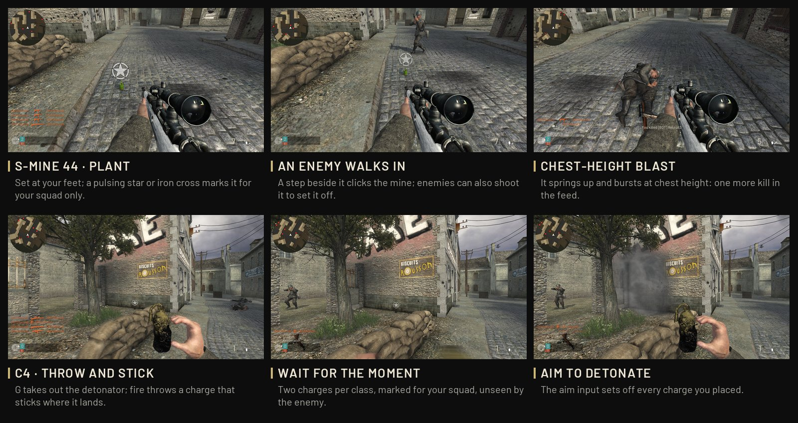

Two placed explosives join the frag as lethal choices. Both carry a pulsing star
or iron cross that your squad sees through walls and the enemy never sees.

- **S-Mine 44:** set it at your feet. An enemy a step beside it clicks it, and it
  springs to chest height and bursts. Enemies can shoot it to set it off, and
  you can take yours back by holding F.
- **C4:** throw a charge and it sticks where it lands; aim detonates every
  charge you placed, wherever you are.

## Bots

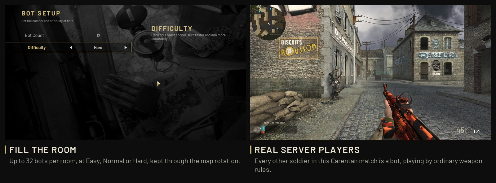

Fill a room with **up to 32 bots** at **Easy, Normal or Hard**, with reaction
delays of 700, 650 and 200 ms. Bots are native server players, not browser
instances: they move through map collision, see through visibility checks that
walls, players and smoke block, and fire and reload under ordinary weapon
rules. Normal and Hard bots seek cover when wounded or reloading; snipers favor
sheltered firing lanes and relocate when compromised.

| Mode | What bots do |
| --- | --- |
| Deathmatch | Patrol, find opponents and fight independently. |
| Team Deathmatch | Spread out, share recent visible contacts, flank and engage at suitable ranges. |
| Capture the Flag | Attack, return and recover flags; intercept carriers, escort teammates and defend bases. |
| Headquarters | Reach the radio, capture or neutralize it, then defend it. |
| Search and Destroy | Split between sites, assign planting and defusing roles and cover the player interacting. |

Bot count and difficulty belong to the room and carry across its map rotation.
A room waits for a human to spawn or spectate before its opening countdown, and
sheds bots while its host cannot keep up. Difficult navigation and tactical
coordination remain areas of active development.
[Behavior, navigation and validation →](docs/BOT_AI.md)

## From the countdown to the final score

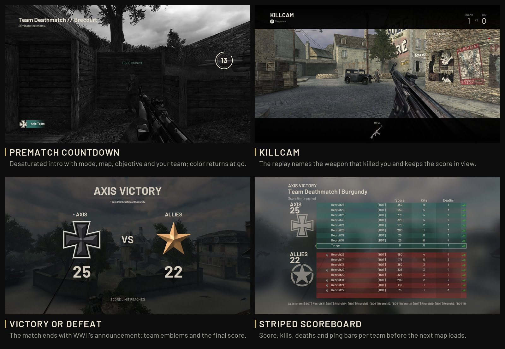

- **Prematch countdown:** 15 seconds of desaturated play with the mode, map,
  objective and your team, until color returns at the start.
- **Killcam** in WWII's style, naming the weapon that killed you.
- **Victory or defeat** announced with team emblems and the final score, then a
  **striped scoreboard** with ping bars before the next map loads.
- **Owner music:** optional host-supplied tracks for the menu, the countdown,
  the last minute and the end of a match. [Private media setup →](docs/UPDATES.md#owner-sound-pack)

## Menus rebuilt in WWII's style

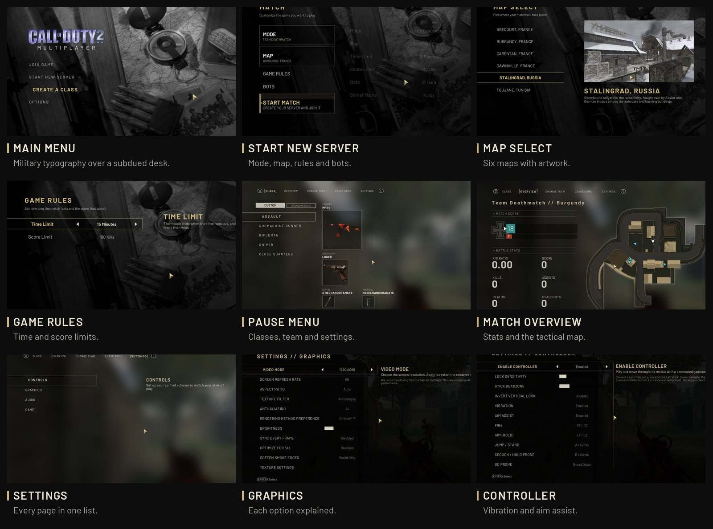

Every screen runs inside the game. Create a server with its mode, map, rules and
bots; pause over the blurred match to change class or team, read the match
overview with its tactical map, or open the settings, where every graphics
option explains itself.

## Rendering beyond the first browser port

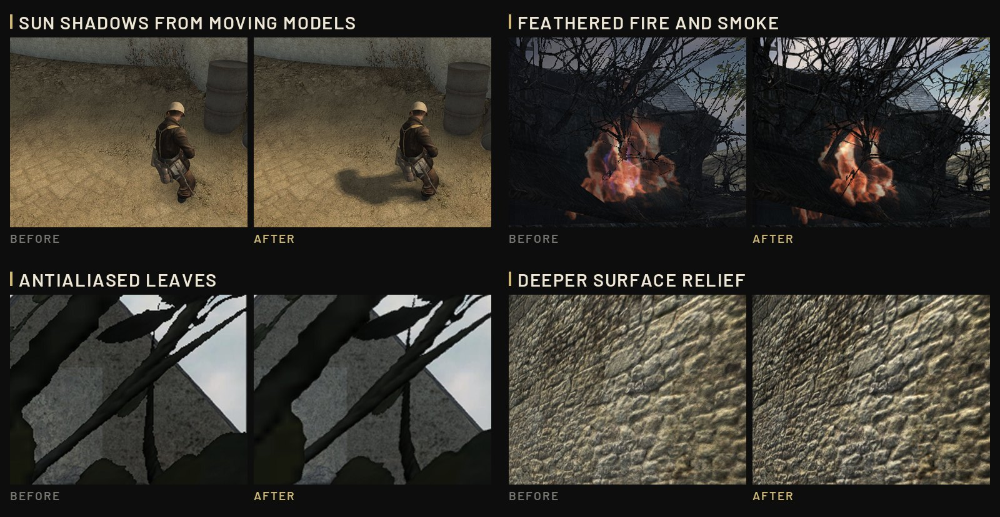

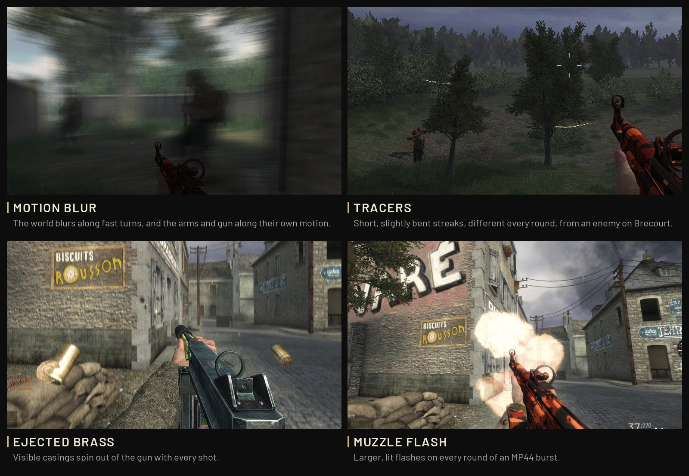

- **Light:** the original normal, specular and detail maps at the DX9
  renderer's full strength give surfaces relief, sunlight response and
  reflections. Players, bodies and other moving models cast real-time sun
  shadows, and ambient occlusion darkens corners and contact points.
- **Atmosphere:** softer baked shadow edges, map fog that thickens toward the
  ground and glows toward the sun, and model detail at twice its original
  distance.
- **Foliage and particles:** leaves, grass and hedges are antialiased and stay
  full in the distance; fire, smoke and dust fade where they meet the world, as
  CoD2's DX9 renderer drew them.
- **Combat:** aim depth of field, camera and weapon motion blur, ejected
  casings, short tracers bent differently every round, larger muzzle and
  grenade effects, and nearby muzzle lighting.

The default output is **1920 × 1080**, with the 3D view at **720 lines**,
full-resolution textures and 16× anisotropic filtering where supported.
Performance depends on the player's hardware, browser and match load.
[Graphics implementation and visual validation →](docs/GRAPHICS_2026-10-16.md)

## Combat with its own rules

- **Sprint** with Shift or L3, weapon lowered; it also stands you up from crouch
  or prone when there is room.
- **105 health** for players and bots, regenerating to full. Bolt-action rifles
  without a scope kill with one shot to the head or chest, as WWII's Kar98k
  with its Iron Sight does, and need two elsewhere; scoped rifles keep their
  lethal body shots, and two melee strikes kill.
- **Real recoil:** each gun kicks by its real free recoil, the cartridge's
  impulse against the gun's loaded weight. A BAR climbs harder than an MP40, a
  Garand kicks harder than a carbine.
- **Damage by cartridge:** up close, four body shots for a 7.62×25 mm round and
  three for 9 mm, .45, intermediate and full-power automatic rounds.
- **Cover penetration:** material, thickness and weapon power decide how much
  damage a bullet keeps through cover; FMJ goes deeper.
- **Mounted MG42:** sustained fire builds heat, forces cooling and increases recoil.
- **Safer respawns:** occupied spawns and those exposed to nearby enemies are
  avoided when safer ones exist. TDM adds a three-second respawn countdown.
- **Movement and feedback:** crouch toggle, prone crawling, obstacle-checked
  mantling, cooked and returned frags, directional damage and blood feedback.

[Weapon balance](downstream/weapon-balance.json) · [Ballistics and controllers](docs/BALLISTICS_AND_GAMEPAD.md) · [Respawn rules](docs/RESPAWN_SAFETY.md)

## Maps and modes

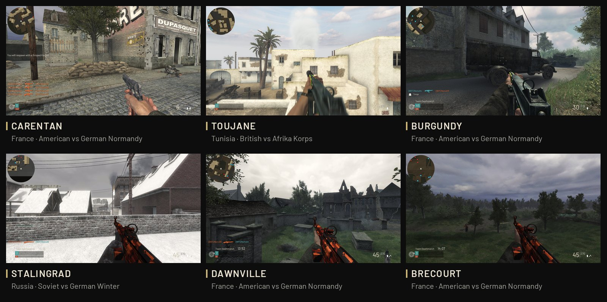

Eight original multiplayer maps, with all five modes available on each:

| Map | Setting | Allied force | Axis force |
| --- | --- | --- | --- |
| **Brecourt** · `mp_brecourt` | France | American | German Normandy |
| **Burgundy** · `mp_burgundy` | France | American | German Normandy |
| **Carentan** · `mp_carentan` | France | American | German Normandy |
| **Dawnville** · `mp_dawnville` | France | American | German Normandy |
| **Leningrad** · `mp_leningrad` | Russia | Soviet | German Winter |
| **Matmata** · `mp_matmata` | Tunisia | British | Afrika Korps |
| **Stalingrad** · `mp_railyard` | Russia | Soviet | German Winter |
| **Toujane** · `mp_toujane` | Tunisia | British | Afrika Korps |

**Deathmatch · Team Deathmatch · Capture the Flag · Headquarters · Search and Destroy**

Time and score limits are configurable per mode. TDM defaults to **15 minutes /
100 team points**. Rooms rotate through Toujane, Carentan, Dawnville, Burgundy,
Stalingrad, Brecourt, Matmata and Leningrad while retaining their mode and rules.

The host starts with no rooms: players create them from **Start New Server**.
The browser list refreshes every five seconds. Up to **three rooms** can coexist,
with **64 configured slots per room**, including bots. These are configuration
limits, not a claim of tested 64-player capacity. Empty rooms close after five
minutes; their creator can also delete them from **Join Game**.

## Play

Once a host is running:

1. Open its address in a browser with WebAssembly and WebGL 2 support.
2. Let the game download and cache the host's prepared assets.
3. Set your gametag in **Options → Game** and build your classes.
4. Create a room with **Start New Server**, or select one in **Join Game**.
5. Choose a class and play. Use Escape for classes, match overview and settings.

Downloads show byte progress and are checked against archive sizes and SHA-256
hashes. Assets stay in IndexedDB between visits; the profile keeps controls,
name, audio and graphics settings. Clearing browser storage removes that profile.
Classes are stored by the gateway in SQLite under the gametag. Leave a match
and join it again under the same gametag, even after closing or reloading the
tab, and your score, kills, assists, headshots and deaths come back, until the
next map or a new match. **Gametags are not authenticated accounts**: anyone
using the same name shares its classes and those stats.
Room ownership is tied to a private token saved in the creator's browser.

### Install as an app

Chrome and Edge can install the game as an app: its own window, and an icon in
the Start menu, on the desktop or in Launchpad and the Dock. Choose **Install app**
in the lower-right corner of the main menu or the loading screen, or the install
button in the address bar. On a Mac, Safari offers **File → Add to Dock**; on an
iPhone or iPad, **Share → Add to Home Screen**. The app opens the host it was
installed from and keeps the files already downloaded. Browsers only install
from an HTTPS address or `localhost`, not from `http://HOST_LAN_IP:8088`.

### Keyboard and mouse

| Action | Default |
| --- | --- |
| Move / lean | W A S D / Q E |
| Fire / aim | Left / right mouse button |
| Sprint / scoped hold breath | Shift while moving forward / Shift while scoped |
| Reload / interact / melee | R / F / V |
| Crouch toggle / prone / stand or jump | C / Ctrl / Space |
| Frag / smoke | G / 4 |
| Cook or return a frag | Hold G, release to throw |
| S-Mine: place / reclaim | G / hold F over your mine |
| C4: equip / throw / detonate | G / fire / aim |
| Public chat / team chat / quick messages | T / Y / H |
| Pause / scoreboard / fullscreen | Escape / Tab / F10 |
| Class selection / edit or rename / camouflage | Enter / F1 / F2 |

Space first stands up from crouch or prone; another press while standing jumps.
Bindings are editable in **Options → Controls**.

### Controller

Connect an Xbox, PlayStation or other SDL-compatible controller and press a
button. Use a browser exposing the Gamepad API over **HTTPS or localhost**.

**RT/R2** fires, **LT/L2** aims, **A/Cross** jumps, **B/Circle** toggles crouch
(hold for prone), **X/Square** uses/reloads, **Y/Triangle** switches weapons,
**LB/L1** throws smoke, **RB/R1** throws a frag, **L3** sprints/holds breath,
**R3** melees and **Start/Options** pauses.

Controller settings include remapping, sensitivity, deadzone, inverted look,
vibration and optional aim assist. Bindings save separately from keyboard/mouse.
Aim assist slows the stick over a visible enemy and follows a small part of
its movement while the player moves a stick. Vibration support varies by browser.

## Host a game

### Requirements

- **Git, Python 3.9+, Node.js, Docker and Docker Compose.** Pi build/deploy tooling
  requires Python 3.12+; see the Pi guide for its complete requirements.
- Your original **CoD2 1.3 English IWDs**, including `localized_english_*.iwd`,
  placed in the ignored `data/main/` directory.
- The original installation ZIP/MP executable for favicon extraction, or a
  prepared `data/browser/web/cod2.ico`. The startup logo uses `data/main/iw_09.iwd`.
- A sibling checkout of **wasm-game-framework**. The build pins **0.9.2** at
  `53bc7e6eeef1ae35dcf3b25dea4e3ec0ab46726f`.

### Host locally

```sh
git clone https://github.com/tonga54/cod2-wasm.git
cd cod2-wasm
git clone https://github.com/theodorecharles/wasm-game-framework.git ../wasm-game-framework

# Copy your original English 1.3 IWD files into data/main/ before continuing.
python3 scripts/prepare-browser-bootstrap.py
python3 scripts/check-private-assets.py

# Set COD2_ORIGINAL_ZIP if your original installation ZIP is elsewhere.
./scripts/build-docker.sh
docker compose up -d
```

Open **http://localhost:8088/** on the host, or **http://HOST_LAN_IP:8088/**
from another machine. Create the first room from the game menu.

The build uses **Emscripten 3.1.64**, through Docker if it is unavailable locally.
`COD2_BUILD_JOBS` controls build parallelism; `COD2_WASM_FRAMEWORK_DIR` changes
the framework checkout path. `COD2_WEB_PORT` changes the published port, and
`COD2_WEB_DATA_DIR` selects the prepared private-data directory.

The current six-map asset manifest totals approximately **473.4 MB** (451.5 MiB).
The exact download depends on the prepared build and optional owner media;
[`site/wasm-game-data.json`](site/wasm-game-data.json) records sizes and hashes.
Original IWDs remain in `data/main/`, prepared files in `data/browser/`. Both
are excluded from Git; private game assets are mounted read-only at runtime.

### How it runs

```text
Player's browser                   Docker host
┌──────────────────────┐          ┌─────────────────────────────────────┐
│ WASM game + WebGL 2  │◄────────►│ Gateway :8088                       │
│ Local rendering      │ HTTP / WS│ ├─ Web shell + private asset delivery│
│ Input + prediction   │          │ ├─ Class storage (SQLite)           │
└──────────────────────┘          │ └─ Room supervisor → native servers │
                                  │                       UDP, internal │
                                  └─────────────────────────────────────┘
```

The standard dedicated engine is **32-bit x86 Linux** inside an amd64 container;
Docker Desktop handles execution on Apple Silicon. The gateway exposes the web
entry point; engine UDP ports and the room supervisor stay on internal networks.
Each room has its own authoritative engine process. The `cod2-classes` volume
persists class data.

### Raspberry Pi 5

A Pi can host the web service, gateway and matches while players render on
their own computers. The tested host is a **Pi 5 with 8 GB RAM, 64-bit Debian
and 4 KiB kernel pages**. Web/gateway/supervisor processes run as ARM64; the
32-bit x86 game engine runs through QEMU.

After preparing the host and your private assets, build on your computer and deploy:

```sh
DOCKER_DEFAULT_PLATFORM=linux/arm64 ./scripts/build-docker.sh
./scripts/deploy-pi.sh USER@PI_LAN_IP
```

The [complete Pi guide](docs/RASPBERRY_PI.md) covers initial setup, HTTPS,
deployment, optional signed Cloudflare asset delivery, updates and troubleshooting.
Use the configured HTTPS address on secured installations.

## Performance and development

Production defaults to **30 server ticks/s**, **30 requested snapshots/s** and
up to **60 input packets/s**. Actual delivery depends on bandwidth and load.
Rendering follows the display cadence, including 120 Hz on suitable clients.

Measured results have different scopes:

| Measurement | Result | Scope |
| --- | --- | --- |
| Pi 5, eight protocol clients + 16 Hard bots | 30.20 updates/s/client; 86.8% of one CPU core | Server/network sample; [report](docs/SERVER_PERFORMANCE_2026-10-13.md). |
| Pi tick-rate comparison | 30 Hz retained as the default | 50 Hz saturated a core under the heavier tested load; [benchmark](docs/TICKRATE_BENCHMARK_2026-10-12.md). |
| Development Mac rendering | About 120 FPS in documented gameplay checks | Specific desktop/display and short samples; [graphics report](docs/GRAPHICS_2026-10-16.md). |
| Browser tab memory, Carentan with 8 bots | 815–836 MB in a match and 375 MB at the menu, from 1,149–1,204 MB and 734 MB | The large archive is read from browser storage on demand; Chromium on the development Mac; [report](docs/STABILITY_AND_SECURITY_2026-10-20.md). |

These are measurements, not minimum FPS or maximum-player guarantees. Bot pathing,
client hardware and crowded matches still need testing under the intended load.
Detailed build, gameplay and deployment evidence is in [RUNBOOK.md](RUNBOOK.md).

### Checks

```sh
# Browser, shared gameplay, rendering, networking and UI regressions
./scripts/test-static.sh

# Gateway: rooms, transport, ownership, classes and updates
(cd downstream/gateway && npm ci && npm test)

# Private asset integrity and custom balance
python3 scripts/check-private-assets.py
python3 scripts/test-weapon-balance.py
```

Runtime checks for classes, explosives and GPU fixtures are documented in the
[technical reference](docs/TECHNICAL_REFERENCE.md#performance-and-verification).

### Updates

```sh
python3 scripts/update-local.py          # Check
python3 scripts/update-local.py --apply  # Fast-forward, rebuild, restart an empty host
```

`main` is the maintained branch. Standard installation requires a clean checkout
and no active players. Pi hosts use the Pi update procedure: validated releases
are checked every five minutes and activated when idle, with rollback on failed
activation. Browser players see an update action after leaving their match and
choose when to reload. [Update operations and cache behavior →](docs/UPDATES.md)

## Documentation

| Guide | Contents |
| --- | --- |
| [Classes and equipment](docs/CLASSES.md) | Weapons, attachments, camouflage, explosives, persistence and limits |
| [Bot AI](docs/BOT_AI.md) | Objectives, perception, navigation, difficulty and test scope |
| [Graphics](docs/GRAPHICS_2026-10-16.md) | WWII-style UI, optics, lighting, effects and visual evidence |
| [Ballistics and gamepad](docs/BALLISTICS_AND_GAMEPAD.md) | Cover penetration, controller behavior and verification |
| [Respawn safety](docs/RESPAWN_SAFETY.md) | Spawn selection and crowded-map behavior |
| [Raspberry Pi](docs/RASPBERRY_PI.md) | Host setup, deployment, HTTPS, CDN and load testing |
| [Updates and private media](docs/UPDATES.md) | Releases, caching, music, sounds and class pictures |
| [Technical reference](docs/TECHNICAL_REFERENCE.md) | Detailed gameplay rules, restored behavior, room API and operational checks |
| [Client performance](docs/PERFORMANCE_2026-10-16.md) / [server performance](docs/SERVER_PERFORMANCE_2026-10-13.md) | Optimization measurements and their limits |
| [Memory, server load and security](docs/STABILITY_AND_SECURITY_2026-10-20.md) | On-demand archives, bounded network queues, the bot governor, gateway limits and container hardening |
| [Runbook](RUNBOOK.md) | Development history, runtime evidence and troubleshooting |
| [Source audit](SOURCE_BASE_AUDIT.md) | Reconstructed source base and provenance |
| [README images](docs/images/README.md) | Where each screenshot and clip on this page comes from |

## Credits and original assets

This fork builds on [theodorecharles/cod2-wasm](https://github.com/theodorecharles/cod2-wasm)
and [wasm-game-framework](https://github.com/theodorecharles/wasm-game-framework).
The interface and several gameplay additions take inspiration from **Call of Duty:
WWII**, adapted to this engine and its multiplayer rules.

Call of Duty names, maps, models, textures, sounds and original executables belong
to their respective rights holders. This is an unofficial project and supplies
neither a copy nor a license of the original games. Hosts must supply their own
original files privately. Screenshots and clips are real captures of the running
project; original game archives and standalone asset packs are not distributed
in this repository.
